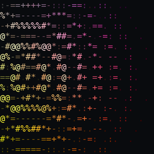

# AsciiCam

Live camera to ASCII art in any terminal — made for the M5Stack Cardputer
Zero, happy anywhere Python runs. The grid follows the terminal size, so it
works on the device's own LCD console and over SSH alike.



## Features

- Four character ramps (classic, dense, minimal, Unicode blocks)
- Truecolour mode: each cell takes its averaged hue, brightness-matched to
  the glyph so colour and character density always agree
- Edge-detection mode, inversion, X/Y flip, live gamma control
- Flicker-free contrast stretch (temporally smoothed percentile bounds)
- Save any frame as a plain-text file
- Sources: Raspberry Pi camera (picamera2), any V4L2/USB webcam (OpenCV),
  or a synthetic test pattern — auto-detected

## Keys

| Key | Action |
|---|---|
| `q` | quit |
| `r` | next character ramp |
| `c` | colour on/off |
| `i` | invert |
| `e` | edge mode |
| `f` / `m` | flip Y / mirror X |
| `[` / `]` | gamma down / up |
| `s` | save frame to text file |

On the Cardputer Zero the camera module is mounted rotated 180°; the picam
source corrects for that automatically.

## Usage

```
asciicam [--source auto|picam|cv|test] [--size WxH] [--fps N] [--frames N]
```

## Install

From the CardputerZero AppStore (share code **ASCI**), or build the .deb
yourself on any Debian system:

```
./build.sh
sudo apt install ./asciicam_*_all.deb
```

Dependencies: `python3-numpy`, `python3-picamera2` (or OpenCV for webcams).

## License

MIT
